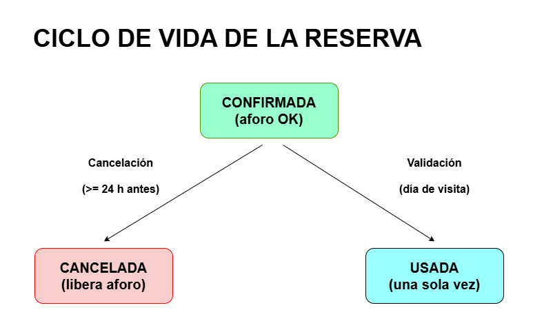
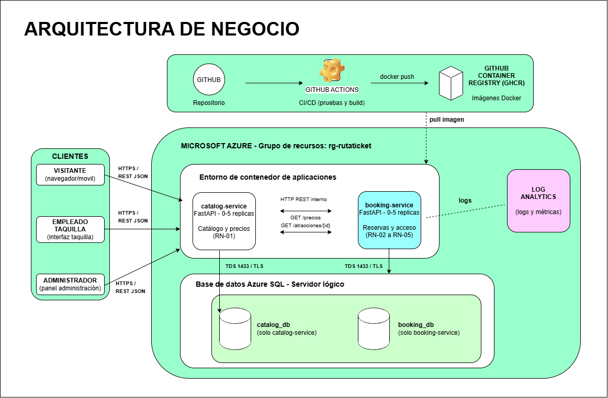
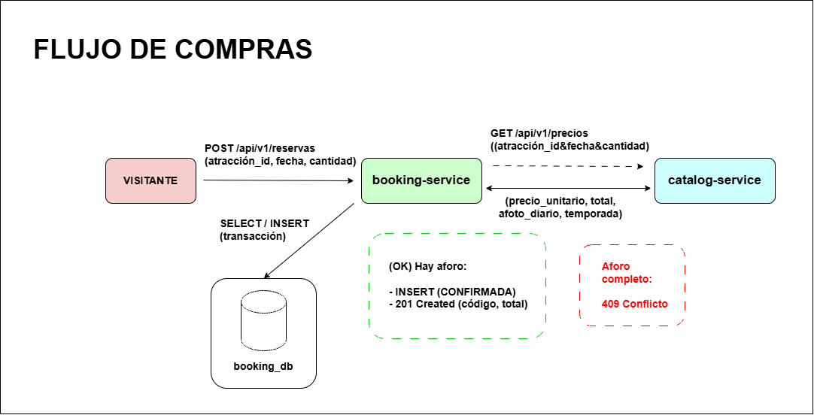

# RutaTicket — Venta de entradas para atractivos turísticos

Aplicación Nativa de la Nube (*Cloud-Native Application*) para una pequeña empresa turística que vende entradas para visitar atractivos turísticos (miradores, rutas guiadas, monumentos, museos), con **precios por temporada** (descuentos en temporada baja o campañas especiales) y **control de aforo diario**. Desplegado sobre **Microsoft Azure**.

---

## Índice

1. [Descripción del dominio](#1-descripción-del-dominio)
2. [Casos de uso principales](#2-casos-de-uso-principales)
3. [Justificación NIST SP 800-145](#3-justificación-nist-sp-800-145)
4. [Mapeo de actores NIST SP 500-292](#4-mapeo-de-actores-nist-sp-500-292)
5. [Arquitectura de referencia](#5-arquitectura-de-referencia)
6. [Especificación de la API REST](#6-especificación-de-la-api-rest)
7. [Gestión del proyecto y flujo de trabajo](#7-gestión-del-proyecto-y-flujo-de-trabajo)

---

## 1. Descripción del dominio

### Problema de negocio

Una pequeña empresa turística gestiona la venta de entradas a varios atractivos de su zona. Hoy lo hace de forma manual (taquilla + hojas de cálculo),
lo que provoca tres problemas:

1. **Sobreventa**: no hay control en tiempo real del aforo diario de cada atractivo, por lo que se venden más entradas de las permitidas.
2. **Precios incoherentes**: los descuentos de temporada (temporada baja, campañas puntuales) se aplican a mano y con errores.
3. **Demanda muy estacional**: en Semana Santa, verano o puentes el tráfico se multiplica, mientras que en temporada baja casi no hay ventas. Mantener servidores propios dimensionados para el pico sería caro e infrautilizado el resto del año.

### Solución

**RutaTicket** permite consultar atractivos, calcular el precio final según la fecha de visita (aplicando automáticamente el descuento de temporada vigente), comprar entradas sin superar el aforo diario, cancelarlas con antelación y validarlas en la puerta mediante un código único.

### Lógica de negocio

| Regla                          | Descripción                                                                                                                                                                                |
|--------------------------------|--------------------------------------------------------------------------------------------------------------------------------------------------------------------------------------------|
| **RN-01 Precio por temporada** | `precio_unitario = precio_base × (1 − descuento / 100)`. Si en una fecha coinciden varias temporadas, se aplica la de **mayor descuento**. Sin temporada vigente, se cobra el precio base. |
| **RN-02 Control de aforo**     | Una compra solo se confirma si `entradas_vendidas(atracción, fecha) + cantidad ≤ aforo_diario`.                                                                                            |
| **RN-03 Fechas válidas**       | No se pueden comprar entradas para fechas pasadas ni con más de 90 días de antelación. Máximo 10 entradas por compra.                                                                      |
| **RN-04 Cancelación**          | Una reserva `CONFIRMADA` puede cancelarse hasta **24 h antes** de la fecha de visita; las plazas vuelven al aforo disponible.                                                              |
| **RN-05 Validación de acceso** | Cada reserva tiene un código único. Solo puede validarse el **día de la visita** y **una única vez** (pasa a estado `USADA`).                                                              |

Ciclo de vida de una reserva:




## 2. Casos de uso principales

| ID    | Actor                | Caso de uso                                                             |
|-------|----------------------|-------------------------------------------------------------------------|
| CU-01 | Administrador        | Dar de alta/modificar atractivos (nombre, precio base, aforo diario).   |
| CU-02 | Administrador        | Definir temporadas de descuento (rango de fechas y porcentaje).         |
| CU-03 | Visitante            | Consultar el catálogo de atractivos y el precio final para una fecha.   |
| CU-04 | Visitante            | Comprar entradas para una fecha (con control de aforo).                 |
| CU-05 | Visitante            | Consultar y cancelar su reserva.                                        |
| CU-06 | Empleado de taquilla | Validar el código de la entrada en el acceso.                           |
| CU-07 | Administrador        | Consultar estadísticas de ventas e ingresos por atractivo.              |

## 3. Justificación NIST SP 800-145

**Modelo de servicio:** PaaS (Azure Container Apps y Azure SQL Database). **Modelo de despliegue:** nube pública (Microsoft Azure, región *Spain Central* / *West Europe*).

| Característica esencial                      | Cómo la aprovecha RutaTicket                                                                                                                                                                                                                                                       |
|----------------------------------------------|------------------------------------------------------------------------------------------------------------------------------------------------------------------------------------------------------------------------------------------------------------------------------------|
| **Autoservicio bajo demanda**                | Toda la infraestructura (Container Apps y Azure SQL Database) se aprovisiona sin intervención humana del proveedor, mediante Terraform y el pipeline de GitHub Actions. Crear un entorno nuevo es ejecutar `terraform apply`.                                                      |
| **Acceso amplio a la red**                   | Los servicios exponen una API REST sobre HTTPS accesible desde cualquier cliente estándar: web del visitante, móvil del empleado de taquilla para validar entradas o la herramienta del administrador.                                                                             |
| **Asignación común de recursos (*pooling*)** | Los contenedores se ejecutan sobre la infraestructura multiinquilino de Azure Container Apps; la base de datos es un servicio gestionado compartido físicamente con otros clientes, aislado lógicamente. La empresa no sabe (ni necesita saber) en qué servidor físico se ejecuta. |
| **Rápida elasticidad**                       | Container Apps escala horizontalmente por número de peticiones HTTP concurrentes (p. ej. de 0 a 5 réplicas). En temporada alta o al lanzar una campaña de descuentos se absorbe el pico; en temporada baja se escala a **cero réplicas**.                                          |
| **Servicio medido**                          | Se paga por vCPU-segundo, GiB-segundo y peticiones consumidas en Container Apps, y por vCore-segundo y GB de almacenamiento en Azure SQL Database (nivel *serverless*). Azure Monitor / Cost Management permiten medir y controlar el consumo.                                     |

## 4. Mapeo de actores NIST SP 500-292

| Rol NIST                           | Quién es en RutaTicket                                                                                                            | Responsabilidad                                                                                                                                    |
|------------------------------------|-----------------------------------------------------------------------------------------------------------------------------------|----------------------------------------------------------------------------------------------------------------------------------------------------|
| **Consumidor (*Cloud Consumer*)**  | La empresa turística (en el proyecto, el alumno que la opera). Indirectamente, sus clientes usan la aplicación.                   | Contrata servicios PaaS de Azure, despliega la aplicación y paga por uso.                                                                          |
| **Proveedor (*Cloud Provider*)**   | Microsoft Azure.                                                                                                                  | Ofrece cómputo (Container Apps), base de datos gestionada (Azure SQL Database), red y registro de logs; garantiza SLA, parches y seguridad física. |
| **Intermediario (*Cloud Broker*)** | En un escenario real, un *partner* CSP (*Cloud Solution Provider*) de Microsoft o Azure Marketplace.                              | Intermediación: agrega facturación, soporte y asesoramiento a la pyme sin personal de TI propio.                                                   |
| **Auditor (*Cloud Auditor*)**      | Auditor externo de cumplimiento (RGPD/AEPD, ISO 27001 o ENS). Herramientas de apoyo: Microsoft Defender for Cloud y Azure Policy. | Evalúa de forma independiente la seguridad, la privacidad de los datos de los visitantes y el rendimiento.                                         |
| **Operador (*Cloud Carrier*)**     | Proveedores de acceso a Internet (de los visitantes y de la empresa) y la red troncal global de Microsoft.                        | Transporta las peticiones HTTPS entre clientes y los centros de datos de Azure.                                                                    |

### Impacto económico

- **De CapEx a OpEx**: la empresa no compra servidores ni licencias; paga mensualmente solo lo que consume. Para una pyme con demanda estacional esto evita sobredimensionar para el pico de verano.
- **Escalado a cero**: en temporada baja Container Apps puede quedarse sin réplicas activas, por lo que el coste de cómputo tiende a cero. Además, Container Apps incluye una cuota gratuita mensual de vCPU-segundos, GiB-segundos y peticiones que cubre holgadamente un tráfico pequeño.
- **Base de datos *serverless***: Azure SQL Database en nivel *serverless* se pausa automáticamente cuando no recibe consultas y solo cobra cómputo mientras está activa. Se usa **un único servidor lógico con dos bases de datos** (`catalog_db` y `booking_db`), manteniendo el patrón *database-per-service*.
- **Coste del proyecto**: la [oferta gratuita de Azure SQL Database](https://learn.microsoft.com/azure/azure-sql/database/free-offer) incluye hasta 10 bases de datos por suscripción, cada una con 100.000 vCore-segundos y 32 GB al mes, configuradas para pausarse al agotar la cuota en lugar de facturar. Junto con la cuota gratuita de Container Apps, el coste del proyecto es prácticamente nulo. Los recursos se destruyen con `terraform destroy` cuando no se usan.
- **Coste de los intermediarios**: un partner CSP (Cloud Solution Provider) añadiría un margen sobre la factura de Azure a cambio de soporte; para una pyme sin informático puede compensar.

## 5. Arquitectura de referencia

La aplicación se divide en **2 microservicios independientes** con su propia base de datos lógica. Cada uno se empaqueta como contenedor Docker y se despliega por separado.

| Componente                                                                  | Responsabilidad                                                                                         | Tecnología                                        |
|-----------------------------------------------------------------------------|---------------------------------------------------------------------------------------------------------|---------------------------------------------------|
| **catalog-service** (Catálogo y Precios)                                    | Atractivos, temporadas de descuento y cálculo del precio final (RN-01).                                 | Python 3.12 + FastAPI                             |
| **booking-service** (Reservas)                                              | Compra, cancelación y validación de entradas; control de aforo (RN-02 a RN-05); estadísticas de ventas. | Python 3.12 + FastAPI                             |
| **Persistencia**                                                            | `catalog_db` y `booking_db` en el mismo servidor lógico.                                                | Azure SQL Database (*serverless*, oferta gratuita)|

### Diagrama



### Protocolos de comunicación

| Origen → Destino                    | Protocolo                                                                    | Tipo       |
|-------------------------------------|------------------------------------------------------------------------------|------------|
| Clientes → microservicios           | HTTPS (TLS terminado en el *ingress* de Container Apps), REST + JSON         | Síncrono   |
| booking-service → catalog-service   | HTTP REST + JSON por la red interna del Container Apps Environment           | Síncrono   |
| Microservicios → Azure SQL Database | Protocolo TDS (SQL Server) sobre TCP 1433 con TLS, vía SQLAlchemy + `pyodbc` | Síncrono   |
| GitHub Actions → GHCR / Azure       | HTTPS (token de GitHub / *service principal*)                                | Despliegue |

**Flujo de compra (CU-04):**



### Decisiones clave

- **Solo 2 microservicios**: separan dos contextos de negocio claros (qué se vende y a qué precio / quién compra y cuándo). Más servicios añadirían complejidad sin valor para el alcance del curso.
- **Comunicación REST síncrona**: suficiente para el volumen de una pyme; evita introducir un *broker* de mensajería.
- **Sin caché**: el enunciado exige persistencia **o** caché; Azure SQL Database cubre el requisito. Si en el Hito 5 las pruebas de carga lo justifican, se valorará cachear las respuestas de `/precios`.
- **Registro de imágenes en GitHub (GHCR)**: gratuito e integrado con GitHub Actions; evita crear y pagar un Azure Container Registry.
- **Secretos mínimos y seguros**: en local, fichero `.env` ignorado por `.gitignore`; en el pipeline, *GitHub Secrets*; en Azure, los **secretos de Container Apps** inyectados como variables de entorno (`DATABASE_URL`). No se usa Key Vault para no añadir otro recurso.
- **Log Analytics**: obligatorio para crear el Container Apps Environment; se reutiliza para la observabilidad del Hito 5.
- **IaC con Terraform** (Hito 3) y **CI/CD con GitHub Actions** (Hitos 2 y 4).

## 6. Especificación de la API REST

Prefijo común: `/api/v1`. Formato: JSON. Fechas en ISO 8601 (`YYYY-MM-DD`). Importes en euros con 2 decimales. Ambos servicios exponen `GET /health` para las sondas de Container Apps.

### 6.1 catalog-service

| Verbo  | Ruta                                             | Descripción                     | Respuestas    |
|--------|--------------------------------------------------|---------------------------------|---------------|
| GET    | `/api/v1/atracciones`                            | Lista atractivos activos        | 200           |
| GET    | `/api/v1/atracciones/{id}`                       | Detalle de un atractivo         | 200, 404      |
| POST   | `/api/v1/atracciones`                            | Crea un atractivo (admin)       | 201, 422      |
| PUT    | `/api/v1/atracciones/{id}`                       | Modifica un atractivo (admin)   | 200, 404, 422 |
| GET    | `/api/v1/temporadas`                             | Lista temporadas de descuento   | 200           |
| POST   | `/api/v1/temporadas`                             | Crea una temporada (admin)      | 201, 422      |
| DELETE | `/api/v1/temporadas/{id}`                        | Elimina una temporada (admin)   | 204, 404      |
| GET    | `/api/v1/precios?atraccion_id=&fecha=&cantidad=` | Calcula el precio final (RN-01) | 200, 404, 422 |

`POST /api/v1/atracciones` — petición:

```json
{
  "nombre": "Mirador del Valle",
  "descripcion": "Visita guiada al mirador",
  "precio_base": 12.00,
  "aforo_diario": 150
}
```

Respuesta `201`:

```json
{
  "id": 1,
  "nombre": "Mirador del Valle",
  "descripcion": "Visita guiada al mirador",
  "precio_base": 12.00,
  "aforo_diario": 150,
  "activa": true
}
```

`POST /api/v1/temporadas` — petición:

```json
{
  "nombre": "Temporada baja invierno",
  "fecha_inicio": "2026-11-01",
  "fecha_fin": "2027-02-28",
  "descuento_porcentaje": 20
}
```

`GET /api/v1/precios?atraccion_id=1&fecha=2026-11-15&cantidad=3` — respuesta `200`:

```json
{
  "atraccion_id": 1,
  "fecha": "2026-11-15",
  "cantidad": 3,
  "precio_base": 12.00,
  "temporada": "Temporada baja invierno",
  "descuento_porcentaje": 20,
  "precio_unitario": 9.60,
  "total": 28.80,
  "aforo_diario": 150
}
```

### 6.2 booking-service

| Verbo| Ruta                                               | Descripción                            | Respuestas         |
|------|----------------------------------------------------|----------------------------------------|--------------------|
| GET  | `/api/v1/disponibilidad?atraccion_id=&fecha=`      | Plazas libres para una fecha           | 200, 404           |
| POST | `/api/v1/reservas`                                 | Compra entradas (RN-02, RN-03)         | 201, 404, 409, 422 |
| GET  | `/api/v1/reservas/{codigo}`                        | Consulta una reserva                   | 200, 404           |
| POST | `/api/v1/reservas/{codigo}/cancelacion`            | Cancela la reserva (RN-04)             | 200, 404, 409      |
| POST | `/api/v1/reservas/{codigo}/validacion`             | Valida la entrada en el acceso (RN-05) | 200, 404, 409      |
| GET  | `/api/v1/estadisticas/ventas?desde=&hasta=`        | Ventas e ingresos por atractivo (admin)| 200                |

`POST /api/v1/reservas` — petición:

```json
{
  "atraccion_id": 1,
  "fecha_visita": "2026-11-15",
  "cantidad": 3,
  "cliente": {
    "nombre": "Ana López",
    "email": "ana@example.com"
  }
}
```

Respuesta `201`:

```json
{
  "codigo": "RT-7F3K9Q",
  "atraccion_id": 1,
  "fecha_visita": "2026-11-15",
  "cantidad": 3,
  "precio_unitario": 9.60,
  "total": 28.80,
  "estado": "CONFIRMADA",
  "creada_en": "2026-10-20T10:35:00Z"
}
```

Respuesta `409` (aforo completo):

```json
{
  "error": "AFORO_COMPLETO",
  "detalle": "Solo quedan 2 plazas para el 2026-11-15"
}
```

`POST /api/v1/reservas/RT-7F3K9Q/validacion` — respuesta `200`:

```json
{ "codigo": "RT-7F3K9Q", "estado": "USADA", "validada_en": "2026-11-15T09:12:00Z" }
```

`GET /api/v1/estadisticas/ventas?desde=2026-11-01&hasta=2026-11-30` — respuesta `200`:

```json
{
  "desde": "2026-11-01",
  "hasta": "2026-11-30",
  "total_entradas": 412,
  "ingresos_totales": 3955.20,
  "por_atraccion": [
    { "atraccion_id": 1, "entradas": 300, "ingresos": 2880.00, "ocupacion_media": 0.67 },
    { "atraccion_id": 2, "entradas": 112, "ingresos": 1075.20, "ocupacion_media": 0.37 }
  ]
}
```
